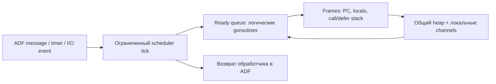

# Предложение Go concurrency на ABAP Daemons

Дата проверки источников: 18 октября 2026. Статус: архитектурная гипотеза и план проверки; frontend/runtime, daemon-прототип и измерения в рамках этого исследования не реализованы. Дополнение к [исследованию Go frontend для HIR и Grace](2026-10-18-go-frontend-hir-feasibility.md).

**Предлагается исследовать множество логических goroutines внутри одной daemon-сессии, а затем — ограниченный пул экземпляров того же daemon-класса.** Число логических goroutines будет ограничиваться ресурсами и лимитами нового runtime; daemon-сессии — ресурсами SAP. Отказ от concurrency в первом Go-профиле остаётся разумным этапом: дальнейшая поддержка требует продолжений, каналов и отдельного контракта памяти.

## Основание в SAP и граница версий

SAP прямо разрешает одному consumer создавать несколько экземпляров одного ABAP Daemon class; singleton является политикой приложения. Это описано уже в [ABAP 7.52: ADF](https://help.sap.com/doc/abapdocu_752_index_htm/7.52/en-US/abenabap_daemon.htm). Современная конфигурация также задаёт число экземпляров и распределение по AS instances/server group. [Configuring Automatically Started ABAP Daemons](https://help.sap.com/docs/ABAP_PLATFORM_NEW/753088fc00704d0a80e7fbd6803c8adb/f86e2e12d7ef4cefad4b35fc57df4061.html).

`rdisp/daemon/max_sessions` ограничивает суммарное число daemon-сессий **на AS instance**, а не число экземпляров отдельного класса. Отдельно действуют work-process quotas `rdisp/scheduler/prio_normal/max_quota`, `rdisp/scheduler/prio_low/max_quota` и параметры максимального времени исполнения. Долгоживущая сессия не означает неограниченное исполнение одного обработчика; значения/defaults нужно снимать с тестовой системы. [Starting ABAP Daemons Explicitly, версия 2022](https://help.sap.com/docs/ABAP_PLATFORM_NEW/753088fc00704d0a80e7fbd6803c8adb/2bfacfa5b4a14b9cb4cf429c847925bd.html?version=202210.latest). Idle daemon не занимает work process; несколько активных daemon-сессий могут претендовать на доступные WP, но это не устанавливает обещанного параллелизма или throughput. [SMDAEMON](https://help.sap.com/docs/ABAP_PLATFORM_BW4HANA/753088fc00704d0a80e7fbd6803c8adb/fba263cee3a342c5a5b64031552c4110.html).

Существующий emitter объявляет стиль ABAP 7.50 ([hir/abap/emit.go](https://github.com/oisee/abapiti/blob/964884687c516465688dfebeac49898ffdbdd2ea/hir/abap/emit.go#L1)), а [README](https://github.com/oisee/abapiti/blob/a0924862a84f65030bc020b51af26818fd9e8d57/README.md#L8) фиксирует тестовую A4H 7.58. Совместимость синтаксиса 7.50 не доказывает наличие ADF runtime на 7.50. Предлагаемый daemon-профиль должен иметь отдельный capability gate и сначала проверяться на фактической 7.58: SAP_BASIS/SP, kernel, доступные классы/сигнатуры, timers, права и профильные параметры. OSGO может проверять алгоритм scheduler, но без специальной модели ADF не подтверждает daemon integration.

## Первый runtime: общий heap в одной daemon-сессии

Предлагаемая структура:

Goroutine предлагается представлять цепочкой resumable frames: program counter, живые locals/temporaries, ссылка на caller, результаты, closure environment, defer/panic state. Блокирующая операция переводит frame в ожидание; scheduler исполняет другие ready frames. Возврат из обработчика освобождает управление SAP, а состояние сохраняется в объектах сессии до следующего события.

Suspension должна распространяться транзитивно через вызовы: если `f` вызывает `g`, где возможен receive, сохранению подлежат обе активации. Нужны анализ эффектов и преобразование reachable call graph, включая recursion, interface/function-value dispatch и callbacks; неизвестный extern требует адаптера либо диагностируемого отказа. Для HIR/Grace понадобятся эффекты suspension/synchronization и запрет перестановок через такие границы без доказательства корректности.

Scheduler предлагается делать round-robin с ограниченным бюджетом шагов и временем tick; точки уступки — также на обратных дугах циклов и длинных цепочках вызовов. Иначе CPU-loop задержит другие goroutines и обработку событий SAP. Budget exhaustion сохраняет frame, планирует следующий tick через поддерживаемый timer/event и возвращает обработчик. Нельзя реализовывать Go blocking через ABAP `WAIT`: ADF запрещает многие блокирующие statements. Разрешённый SAP synchronous RFC тоже способен задержать всю логическую очередь, поэтому требует отдельного ограничения/адаптера. [Programming Model for ABAP Daemons Events](https://help.sap.com/docs/ABAP_PLATFORM_NEW/753088fc00704d0a80e7fbd6803c8adb/3d31e40f220d4904ad3a54fd775022d4.html). Timer API документирован SAP; конкретный механизм повторного tick и отсутствие lost wakeup предстоит проверить. [Implementing an ABAP Daemon Class](https://help.sap.com/docs/ABAP_PLATFORM_NEW/753088fc00704d0a80e7fbd6803c8adb/b9c59d96f6804e7281fdf6f403f16bba.html).

Fairness — проверяемая политика, без обещаний real-time/starvation-freedom. Пустая ready queue при ожидаемом timer/I/O означает ожидание; объявлять deadlock можно лишь после учёта всех источников пробуждения.

## Каналы: контракт языка и предложенная реализация

Для закреплённой версии Go должны сохраняться следующие правила:

| Операция | Обязательная семантика |
|---|---|
| `go f(args)` | Function value и arguments вычисляются в вызывающей goroutine; вызов исполняется отдельно. |
| Unbuffered channel | Send/receive встречаются попарно; send не завершается без соответствующего receive. |
| Buffered channel | Ограниченная ёмкость и FIFO значений; полный/пустой канал блокирует соответствующую операцию. |
| `nil` channel | Send/receive блокируются навсегда; соответствующий case не становится готовым. |
| `close` | Буфер сначала дочитывается, затем receive возвращает zero value и `ok=false`; send в закрытый, повторный close и close(nil) вызывают panic. |
| `select` | Channel operands и RHS send вычисляются однократно в исходном порядке; выбирается ровно один готовый case равновероятным псевдослучайным выбором; `default` — только при отсутствии готовых; иначе ожидание. LHS receive вычисляется после выбора. |

Это требования [спецификации Go, закреплённый источник 1.26](https://github.com/golang/go/blob/go1.26.0/doc/go_spec.html), а не свойства APC/AMC.

Для локального runtime предлагаются channel object с типом, capacity, closed flag, ring buffer, send/receive waiters и отдельный select-ticket. Единственный scheduler-владелец атомарно выполняет check-ready/register-wait и commit select-ticket; проигравшие registrations снимаются. Случайный выбор нужен между готовыми cases, а не просто между различными channel objects: несколько cases могут ссылаться на один канал. Блокировка должна сохранять уже вычисленные operands, без повторных побочных эффектов после resume. Channel identity, `len/cap`, direction checks и range-until-closed требуют отдельных semantic gates.

## Память и несколько daemon workers

Go memory model требует связей happens-before: создание goroutine предшествует её началу; send — завершению соответствующего receive; close — receive, вернувшему zero из-за закрытия; для unbuffered receive предшествует завершению send. Для capacity C, k-й receive предшествует завершению (k+C)-го send. Завершение goroutine само по себе не является join. Для data-race-free программ допустимо последовательное чередование goroutines; поэтому один executor не препятствует корректной concurrency. Однако это не разрешает менять aliasing или игнорировать правила для программ с гонками. [The Go Memory Model](https://go.dev/ref/mem).

В одной сессии можно предложить общий heap для pointers, globals, closure cells и slice backing stores. Передача значения через канал должна сохранять предусмотренные Go копирование и shared references; глубокая сериализация произвольного графа меняет наблюдаемое поведение. Между ABAP internal sessions обычные object references не являются общим heap: SAP размещает обычные class instances внутри internal session; shared objects — отдельный механизм. [Sessions and Memory Areas](https://help.sap.com/doc/abapdocu_752_index_htm/7.52/en-us/abenmemory_organization.htm).

Поэтому следующий эксперимент с несколькими экземплярами одного класса предлагается ограничить независимыми runtime instances или worker-задачами с проверенным контрактом копируемых данных. Это отдельный actor/message profile; произвольные shared-pointer goroutines переносить нельзя. Возможные дальнейшие направления — закрепление совместно используемого heap за владельцем и прокси-доступ либо доказанная изоляция данных; оба требуют отдельного протокола, effects и тестов. Ни SAP Shared Objects, ни сериализация сами по себе не доказывают Go shared-memory compatibility. Отдельно потребуются реализации `sync`/`sync/atomic` и соответствующие гарантии, если такие импорты разрешены.

## Транспорт, внешнее I/O и отказы

AMC publish/subscribe доставляет публикацию подписчикам; SAP прямо указывает, что отправитель не знает, зарегистрирован ли нужный получатель, и называет такую коммуникацию unreliable. Это не rendezvous, bounded buffer или выбор одного получателя Go channel. [Collaboration between APC and AMC, версия 2023](https://help.sap.com/docs/ABAP_PLATFORM_NEW/05d041d3df1a4595a3c45f57c15e2325/4e50938749b049a793e2dd77ba7e8458.html?version=202310.000). Вместе с тем в AMC есть и point-to-point API; нельзя приписывать свойства publish/subscribe всем режимам AMC. [AMC Architecture](https://help.sap.com/docs/ABAP_PLATFORM_BW4HANA/05d041d3df1a4595a3c45f57c15e2325/04ff7d5d5fd54a58ac51027a198a410b.html).

Для управления workers стоит сравнить адресованные daemon messages по instance ID и доступный point-to-point AMC. Daemon manager ограничивает доступ creator program; общий wrapper и разрешения следует проверить до выбора маршрутизации. [Interacting with ABAP Daemons](https://help.sap.com/docs/ABAP_PLATFORM_NEW/753088fc00704d0a80e7fbd6803c8adb/348b75a85ec7495e975c68a7f1e9b0cb.html). Протокол требует runtime/channel ID, epoch, operation ID, completion ACK, bounds/backpressure и обработки дублей/таймаутов. Успех transport-send нельзя считать завершением Go-send. ACK/deduplication не доказывают exactly-once внешние эффекты. Распределённый select потребовал бы отдельного атомарного арбитра/протокола и исключается из первого worker proof.

APC — кандидат для внешнего событийного I/O: SAP поддерживает full-duplex WebSocket и TCP, роли client/server. [ABAP Push Channels](https://help.sap.com/docs/ABAP_PLATFORM_BW4HANA/05d041d3df1a4595a3c45f57c15e2325/99911508963d452c80d9def3dd864f4f.html). Предлагаемый адаптер сохраняет ожидающий frame и возобновляет его по completion/error; framing, partial reads/writes, deadlines, cancel и close требуют собственного контракта. Это ещё не реализация всей Go `net`/`os` standard library. Привязка APC к AMC относится к WebSocket, не ко всем TCP-соединениям. [APC/AMC collaboration](https://help.sap.com/docs/ABAP_PLATFORM_NEW/05d041d3df1a4595a3c45f57c15e2325/4e50938749b049a793e2dd77ba7e8458.html?version=202310.000).

Restart daemon очищает session memory и соединения; application/start parameters и необработанные daemon messages сохраняются. Необработанные AMC messages могут сохраниться при восстановлении регистраций. SAP предоставляет ограниченную daemon memory для явно сохранённого context. [Implementing an ABAP Daemon Class](https://help.sap.com/docs/ABAP_PLATFORM_NEW/753088fc00704d0a80e7fbd6803c8adb/b9c59d96f6804e7281fdf6f403f16bba.html). **Это не прозрачное восстановление Go heap, call/defer stack и уже выполненных эффектов.** Для первого профиля предлагается завершать затронутый Go runtime с явным infrastructure failure, отличимым от source panic, и запускать новый runtime только как новую execution epoch. Старые queued messages должны отвергаться по epoch. Checkpoint/replay допустим лишь как последующий прикладной протокол; нельзя автоматически повторять произвольные Go goroutines после сбоя.

## Проверяемые этапы

1. **Capability probe на SAP 7.58.** Зафиксировать API, kernel/SP, права, quotas; создать два экземпляра одного класса, проверить адресацию, timer tick, Idle/WP state и корректную остановку. Это проверка платформы, не Go support.
2. **Scheduler/continuation proof.** Несколько логических goroutines в одном daemon: вложенный suspend, recursive call, сохранённые temporaries, loop yield, пробуждение по timer; trace без потери/повтора шагов. Проверить прогресс короткой задачи рядом с CPU-loop в рамках объявленного tick budget.
3. **Local channel corpus.** Rendezvous и capacity 1/N; full/empty; nil; close с ожидающими senders/receivers; selected/unselected side effects; несколько ready cases, duplicate cases, отсутствие lost wakeup/double commit. Memory-model litmus tests и shared-pointer/closure/slice alias tests. Defer/panic, завершение `main` и прочие lifecycle cases вводить с явным gate.
4. **APC adapter и failure injection.** Completion/timeout/close, backpressure; daemon restart до/после channel commit и external effect; stale epoch, восстановление subscriptions, очистка waiters. Проверить, что infrastructure failure не маскируется Go recover или успешным повтором.
5. **Опциональный worker pool.** Два экземпляра одного класса, только проверяемые изолированные задачи; тесты order/duplicate/late response/quota rejection. Произвольные shared-pointer goroutines и распределённый select остаются явным refusal.

Сравнивать native Go с generated runtime по допустимым наблюдаемым результатам и happens-before, а не по одному случайному schedule. Использовать воспроизводимые seeds/bounded exploration; corpus не доказывает полную корректность. Grace off/on — отдельный gate. Регистрировать исходники, flags, версии, traces, отказы и raw SAP outputs. Измерять memory per suspended frame, wakeup latency, event processing time и WP usage на фиксированной нагрузке. До измерений нельзя обещать миллионы goroutines, линейное масштабирование или производительность Go runtime.
