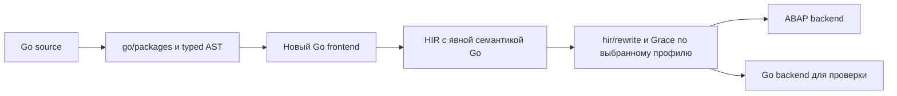

# Исследование Go frontend для HIR Grace и ABAP

Дата: 18 октября 2026. Статус: исследование и варианты дальнейшей проверки.

**Вывод:** путь реалистичен для явно ограниченного Go-подмножества; обязательный SSA не нужен. Уже есть подходящая структурированная HIR, верификатор, два backend и адаптер Grace. Основная работа — сохранить Go-семантику значений, памяти и runtime, которую существующая HIR проектировала преимущественно под TypeScript. Наличие Go-backend не означает наличие Go-frontend. Frontend и прототип в рамках этого исследования **не реализованы**.

Продолжение исследования: [предложение goroutines и channels через ABAP Daemons, APC и AMC](2026-10-18-go-concurrency-abap-daemons-proposal.md). Это отдельный будущий runtime-профиль, без реализации и измерений.

Предлагаемый путь:

## Состояние main и интеграционной ветки

База исследования: опубликованный `main` **a0924862a84f65030bc020b51af26818fd9e8d57** и интеграционная ветка **964884687c516465688dfebeac49898ffdbdd2ea**. Далее **M** означает первый commit, **I** — второй. Ссылки `path:line` относятся к I, если M не указан.

Для стабильной навигации: [дерево M](https://github.com/oisee/abapiti/tree/a0924862a84f65030bc020b51af26818fd9e8d57), [дерево I](https://github.com/oisee/abapiti/tree/964884687c516465688dfebeac49898ffdbdd2ea). Языковая база — Go 1.26 (`go.mod:3`). Версионные правила закреплены за [исходником спецификации Go 1.26](https://github.com/golang/go/blob/go1.26.0/doc/go_spec.html).

Состояние существующих путей:

- M действительно документирует **11 060** Node-active abaplint-тестов на TS-HG@Go, TS-HA@OSGO и TS-HA@A4H; A4H — реальный SAP 7.58. Это свидетельство TypeScript pipeline, а не Go-source compatibility; в исследовании результат заново не воспроизводился. [README M:8](https://github.com/oisee/abapiti/blob/a0924862a84f65030bc020b51af26818fd9e8d57/README.md#L8).
- В M `Program` содержит **Classes, Interfaces**; в I добавлены **Unions**. `BigInt`, `UnionRef`, `ExternCall` — integration additions. Обобщать их на опубликованный main нельзя. [HIR M:68](https://github.com/oisee/abapiti/blob/a0924862a84f65030bc020b51af26818fd9e8d57/hir/hir.go#L68), [HIR I:72](https://github.com/oisee/abapiti/blob/964884687c516465688dfebeac49898ffdbdd2ea/hir/hir.go#L72), [hir/extern.go:5](https://github.com/oisee/abapiti/blob/964884687c516465688dfebeac49898ffdbdd2ea/hir/extern.go#L5).
- M явно помечает `wasm/` и `abap/wasm_compiler/` deprecated. `llvm/` описан отдельно, с ограниченной проверкой; утверждать по этому основанию, что весь LLVM-путь deprecated, нельзя. Go → ABAP указан как отсутствующий. [README M:254](https://github.com/oisee/abapiti/blob/a0924862a84f65030bc020b51af26818fd9e8d57/README.md#L254).

## Существующие HIR и backend

[hir/hir.go:8](https://github.com/oisee/abapiti/blob/964884687c516465688dfebeac49898ffdbdd2ea/hir/hir.go#L8) содержит Bool, binary64 Number, I32/I64, UTF-16 String, Optional, settled Promise, ClassRef, InterfaceRef, ClassValue, Array, OrderedMap/Set, RegExp, Dynamic; I добавляет BigInt и UnionRef. `Type{Kind,Name,Args}` не имеет общей модели Go named types, указателей, функций, фиксированных массивов или slices. `ClassValue` — **дескриптор конструктора класса**, не value struct ([hir/golang/emit.go:429](https://github.com/oisee/abapiti/blob/964884687c516465688dfebeac49898ffdbdd2ea/hir/golang/emit.go#L429), [hir/abap/emit.go:341](https://github.com/oisee/abapiti/blob/964884687c516465688dfebeac49898ffdbdd2ea/hir/abap/emit.go#L341)). `Structural` также не превращает class reference в Go-значение.

Объявления: классы с полями, constructor и методами, интерфейсы с методами; `Method.Result` один ([hir/hir.go:93](https://github.com/oisee/abapiti/blob/964884687c516465688dfebeac49898ffdbdd2ea/hir/hir.go#L93), [hir/hir.go:144](https://github.com/oisee/abapiti/blob/964884687c516465688dfebeac49898ffdbdd2ea/hir/hir.go#L144)). Выражения включают locals, поля, индексы, вызовы, allocation, арифметику, conditional, casts, runtime operations и `Seq`. Statements — Block/VarDecl/Assign/If/While/ForEach/Break/Continue/Return/Throw/Try/Finally. Нет общего goto, label, address-of, dereference или function-value call. `ForEach` рассчитан на HIR Array; loop control не несёт пользовательского target label ([hir/verify.go:516](https://github.com/oisee/abapiti/blob/964884687c516465688dfebeac49898ffdbdd2ea/hir/verify.go#L516)).

Backend Go действительно хранит HIR String как `jsString` с UTF-16LE units, Array как `*array[T]`, maps как указатели на ordered collections. ABAP использует `string`, объектные references и runtime collection objects ([hir/golang/runtime.go:23](https://github.com/oisee/abapiti/blob/964884687c516465688dfebeac49898ffdbdd2ea/hir/golang/runtime.go#L23); [hir/golang/emit.go:405](https://github.com/oisee/abapiti/blob/964884687c516465688dfebeac49898ffdbdd2ea/hir/golang/emit.go#L405); [hir/abap/emit.go:318](https://github.com/oisee/abapiti/blob/964884687c516465688dfebeac49898ffdbdd2ea/hir/abap/emit.go#L318)). Это полезная инфраструктура, но не готовый ABI Go.

Оба emitter начинают с `hir.Verify`; ABAP проверяет каталог runtime operations, Go обходит тела через `checkOps` ([hir/abap/emit.go:133](https://github.com/oisee/abapiti/blob/964884687c516465688dfebeac49898ffdbdd2ea/hir/abap/emit.go#L133); [hir/golang/emit.go:32](https://github.com/oisee/abapiti/blob/964884687c516465688dfebeac49898ffdbdd2ea/hir/golang/emit.go#L32), [hir/golang/emit.go:99](https://github.com/oisee/abapiti/blob/964884687c516465688dfebeac49898ffdbdd2ea/hir/golang/emit.go#L99), [hir/golang/emit.go:1470](https://github.com/oisee/abapiti/blob/964884687c516465688dfebeac49898ffdbdd2ea/hir/golang/emit.go#L1470)). Verify проверяет разрешённость типов/объявлений, signature/arity, присваивания, statements и runtime signatures ([hir/verify.go:196](https://github.com/oisee/abapiti/blob/964884687c516465688dfebeac49898ffdbdd2ea/hir/verify.go#L196), [hir/verify.go:462](https://github.com/oisee/abapiti/blob/964884687c516465688dfebeac49898ffdbdd2ea/hir/verify.go#L462), [hir/verify.go:680](https://github.com/oisee/abapiti/blob/964884687c516465688dfebeac49898ffdbdd2ea/hir/verify.go#L680), [hir/verify.go:950](https://github.com/oisee/abapiti/blob/964884687c516465688dfebeac49898ffdbdd2ea/hir/verify.go#L950)). Это проверка текущего контракта HIR, не доказательство сохранения Go-семантики.

Поддержка между backend неодинакова: I умеет UnionRef в Go, но ABAP отказывает в recursive-family ABI ([hir/abap/ops.go:52](https://github.com/oisee/abapiti/blob/964884687c516465688dfebeac49898ffdbdd2ea/hir/abap/ops.go#L52); [hir/golang/ops.go:12](https://github.com/oisee/abapiti/blob/964884687c516465688dfebeac49898ffdbdd2ea/hir/golang/ops.go#L12)). `extern.call` в I имеет ограниченный signature и прямо отвергается ABAP как Go-only ([hir/extern.go:13](https://github.com/oisee/abapiti/blob/964884687c516465688dfebeac49898ffdbdd2ea/hir/extern.go#L13); [hir/abap/emit.go:1058](https://github.com/oisee/abapiti/blob/964884687c516465688dfebeac49898ffdbdd2ea/hir/abap/emit.go#L1058)). В M Finally запрещает выходы return/break/continue из Body ([hir/verify.go M:541](https://github.com/oisee/abapiti/blob/a0924862a84f65030bc020b51af26818fd9e8d57/hir/verify.go#L541)); I поддерживает abrupt completions ([hir/hir.go:234](https://github.com/oisee/abapiti/blob/964884687c516465688dfebeac49898ffdbdd2ea/hir/hir.go#L234)). Это ещё не Go defer/recover.

`emit-go` — команда **TypeScript → HIR → Go** ([cmd/abapiti/emit_go.go:18](https://github.com/oisee/abapiti/blob/964884687c516465688dfebeac49898ffdbdd2ea/cmd/abapiti/emit_go.go#L18), [cmd/abapiti/emit_go.go:73](https://github.com/oisee/abapiti/blob/964884687c516465688dfebeac49898ffdbdd2ea/cmd/abapiti/emit_go.go#L73)). Найденное использование `go/parser` в [hir/golang/collection_fastpath.go:35](https://github.com/oisee/abapiti/blob/964884687c516465688dfebeac49898ffdbdd2ea/hir/golang/collection_fastpath.go#L35) разбирает уже сгенерированный Go для адаптации runtime; это не исходный Go frontend.

## Typed AST без обязательного SSA

`go/parser`, `go/ast`, `go/types` и `go/constant` входят в стандартную библиотеку. `go/packages` относится к отдельному модулю `golang.org/x/tools`; его версию нужно согласовать с выбранным toolchain.

Для реального module/package input рекомендуется `golang.org/x/tools/go/packages`: `LoadSyntax` даёт typed syntax начальных packages; `LoadAllSyntax` добавляет зависимости. Нужно проверять package errors, фиксировать build tags, module/toolchain, GOOS/GOARCH и cgo policy. Для маленького однопакетного proof достаточно `go/parser` + `go/types.Config.Check`; самостоятельный loader затем должен решать выбор файлов и imports. [go/packages](https://pkg.go.dev/golang.org/x/tools/go/packages), [go/parser](https://pkg.go.dev/go/parser).

`types.Info` предоставляет Types/constant values, Defs, Uses, Selections, Scopes, Implicits, Instances и InitOrder; TypeAndValue — в том числе addressability, Signature — tuple результатов. `Config.GoVersion` и `Sizes` помогают зафиксировать язык и размеры. Это AST плюс semantic side tables, не готовая lowered IR; Instances не генерирует тела специализаций. Идентичность `types.Object` следует сохранять, не восстанавливать по тексту имени. [go/types](https://pkg.go.dev/go/types#Info).

Синтаксис можно вывести существующими `ast.Print`/`ast.Fprint`; типы, разрешённые selectors/calls и константы дополняются из `types.Info`, представления типов — через `types.TypeString`. Такой диагностический dump полезен как первый результат будущего frontend, но сам по себе ещё не является semantic lowering. [go/ast](https://pkg.go.dev/go/ast#Print).

Frontend всё ещё обязан нормализовать lvalues, порядок эффектов, zero initialization, копирование, receiver adaptation, builtins, package initialization, closures и library calls. Константы следует брать через `go/constant`, не округлять заранее к float64. [go/constant 1.26](https://pkg.go.dev/go/constant@go1.26.0).

Структурированные Go if/for естественно понижаются в Block/If/While. У `for init; cond; post` continue должен выполнять post; простое добавление post в конец Body ошибочно. Switch можно разворачивать с однократной оценкой tag, контролем fallthrough и отдельным switch-break. Range требует lowering по типу, а не единого `ForEach`.

Для labeled break/continue и goto есть выбор: первое подмножество явно отказывает; либо frontend использует exit flags/dispatcher; либо HIR получает явные labels/branches. Общий CFG и его структурирование могут понадобиться именно этим конструкциям. Они не следуют из самого выбора Go frontend. SSA полезен позднее для def-use, анализов и независимых проверок. `x/tools/go/ssa` уже заменяет структурированный control flow блоками и переходами; при обязательном SSA пришлось бы возвращать структуру для нынешнего HIR. [официальное описание SSA](https://pkg.go.dev/golang.org/x/tools/go/ssa#hdr-Overview).

## Семантические требования и варианты представления HIR

Free functions можно сначала представить static methods синтетического package-класса, globals — static fields, несколько результатов — синтетическим result record. `Program.Functions`, `Program.Types`, отдельные tuples/structs удобны для ясности и verifier, но **не обязательны для первого корректного подмножества**. Нужно отдельно реализовать eager Go package initialization; существующий implicit `class_constructor`/first-use mechanism не заменяет его ([hir/rewrite/ensure_init.go:18](https://github.com/oisee/abapiti/blob/964884687c516465688dfebeac49898ffdbdd2ea/hir/rewrite/ensure_init.go#L18)).

| Область | Разрыв и возможный минимальный путь |
|---|---|
| **Строки** | Go string — неизменяемые произвольные байты, включая invalid UTF-8 и NUL; len/index/slice работают с байтами, range декодирует UTF-8. Нельзя использовать HIR UTF-16 String напрямую. Вариант: семантически отдельный GoString, Go backend — native string, ABAP — byte-preserving `xstring` с проверенными операциями. Либо wrapper + helper ops; название нового Kind не принципиально. Text conversion только на объявленных границах. [Go strings](https://go.dev/blog/strings). |
| **Struct и [N]T** | Нужны copy-on-assignment/parameter/return/value-receiver semantics. Копируются вложенные value fields; pointer/map/slice fields сохраняют соответствующее aliasing, поэтому универсальный deep clone неверен. Можно начать с reference classes и explicit fresh-copy helpers, исключив взятие адреса. Для общего случая важна также адресуемая storage identity. [Effective Go: arrays](https://go.dev/doc/effective_go#arrays), [Go FAQ: value passing](https://go.dev/doc/faq#pass_by_value). |
| **Указатели** | General `*T` не равен ClassRef. Нужны nil, адресуемые locals, поля и элементы, разыменование, equality, escaping lifetime. Для `p := &s.f; s = other` p обязан продолжать указывать на поле той же переменной: замена box при каждом присваивании ломает interior pointers. Возможны cells + owner/path address handles, стабильные element storage или новые pointer nodes; сначала разумно отказаться от адресов. |
| **Slices** | Копируемый descriptor `{backing,offset,len,cap}` разделяет backing; header каждой копии независим. `append` может сохранить backing или выделить новый, subslice ограничивается len/cap; nil отличается от empty. Нынешний shared HIR Array object этого не выражает автоматически. Wrapper headers + backing class возможны без немедленной смены Program. Нужны zero-filled make, full slices, bounds, overlapping copy и адреса элементов. [Go slices](https://go.dev/blog/slices-intro). |
| **Maps** | Нужны nil read/len/delete, panic при nil write, zero-value missing lookup + comma-ok, copied values, comparable keys. Struct/array keys не равны ссылочным ключам; NaN не следует JS SameValueZero. OrderedMap можно использовать лишь за адаптером, который доказывает нужные операции; текущий verifier ограничивает keys ([hir/verify.go:235](https://github.com/oisee/abapiti/blob/964884687c516465688dfebeac49898ffdbdd2ea/hir/verify.go#L235)). Порядок обхода Go не гарантирован; snapshot keys недостаточен без проверки поведения delete/insert во время range. [Go maps](https://go.dev/blog/maps). |
| **Interfaces** | Требуется dynamic type + value, различение nil interface и typed nil, boxing value copies, method sets T/*T, assertions/type switches и проверка comparability при equality. InterfaceRef/Dynamic не доказывают всё это. Возможен descriptor + payload + dispatch-table wrapper с ограниченным набором типов. [Go interfaces/reflection](https://go.dev/blog/laws-of-reflection), [typed nil FAQ](https://go.dev/doc/faq#nil_error). |
| **Числа** | Уже имеющиеся I32/I64 используют checked arithmetic: `checkedI32`, `checkedAddI64` и integer helpers ([hir/golang/emit.go:1065](https://github.com/oisee/abapiti/blob/964884687c516465688dfebeac49898ffdbdd2ea/hir/golang/emit.go#L1065)); это не Go overflow. Verifier не принимает bitwise/shift operators ([hir/verify.go:764](https://github.com/oisee/abapiti/blob/964884687c516465688dfebeac49898ffdbdd2ea/hir/verify.go#L764)). Нужны unsigned 8/16/32/64, signed widths, shifts/conversions, float32 rounding и отдельное решение complex. Зафиксировать target int/uint, например 64-bit, совместно с checker Sizes; ABAP int8 не представляет весь uint64. Варианты: modulo helpers, limbs/bytes, доказанное ограничение диапазона; JS BigInt из I сам по себе этого не решает. |
| **Multiple results и assignment** | Result-record допустим, но callee вычисляется один раз. Для `a,b=b,a` и `i,a[i]=...` сначала сохранить вычисленные RHS и адреса LHS, затем выполнять stores с требуемой последовательностью; учитывать `_`, comma-ok и `:=` shadowing. Нельзя просто выпустить последовательные HIR Assign без временных значений. |
| **Defer/panic/recover** | Нужен стек deferred calls: function/arguments сохраняются при defer, вызовы идут LIFO при выходе, named results остаются изменяемыми. Recover зависит от контекста deferred call, а не общего catch. Finally может быть механизмом реализации, но не готовым контрактом; Throw/Trap сейчас разделяют source payload и coverage refusal. Runtime panic и unsupported trap должны остаться различимыми. [Go defer/panic/recover](https://go.dev/blog/defer-panic-and-recover). |
| **Closures** | Нужны code + environment, захват изменяемых переменных через shared cells, method values/expressions, nil function и правильное время захвата receiver. Реалистичен synthetic class с `call` и environment fields. Новая function kind — вариант, не обязательное условие. Loop variables требуют правил выбранной Go-версии; нельзя переносить старую модель одного loop variable. [Go 1.22 loop change](https://go.dev/blog/loopvar-preview). |

Числовые overflow/conversion, адресуемость, порядок assignment, initialization и labels — нормативные требования [спецификации Go 1.26](https://github.com/golang/go/blob/go1.26.0/doc/go_spec.html). Рекомендации по cells, wrappers и helper ops выше — проектные варианты этого исследования, не требования стандарта. Type checker подтверждает допустимость исходника, но не правильность выбранной реализации памяти.

Для первого профиля предлагается явный отказ от goroutines/channels/select, общего reflection, unsafe, cgo и необработанных generic instances. Settled Promise не является scheduler ([hir/hir.go:16](https://github.com/oisee/abapiti/blob/964884687c516465688dfebeac49898ffdbdd2ea/hir/hir.go#L16)). Concurrency потребовала бы отдельного runtime и memory-model contract; простая последовательная замена некорректна. [Go memory model](https://go.dev/ref/mem). Generics можно позднее специализировать для конечной reachable closure, сохраняя type identity и constraints; type checking не делает monomorphization автоматически. [Go generics](https://go.dev/doc/tutorial/generics). Reflection, unsafe и cgo требуют самостоятельной границы capabilities/ABI, включая зависимости standard library. [reflect model](https://go.dev/blog/laws-of-reflection), [unsafe](https://pkg.go.dev/unsafe), [cgo](https://pkg.go.dev/cmd/cgo).

## Роль Grace и необходимые расширения

`grace/` — независимый Go engine фактов, joins, rule parsing/evaluation, demand и invalidation; [hir/rewrite/core.go:1](https://github.com/oisee/abapiti/blob/964884687c516465688dfebeac49898ffdbdd2ea/hir/rewrite/core.go#L1) адаптирует его к HIR. Extractor, effects, native transformations и `.grace` rules находятся в `hir/rewrite/`. `Analyze` проверяет HIR ([analyze.go:14](https://github.com/oisee/abapiti/blob/964884687c516465688dfebeac49898ffdbdd2ea/hir/rewrite/analyze.go#L14)); `Rewrite` ограничивает рост/раунды и проверяет результат ([rewrite.go:46](https://github.com/oisee/abapiti/blob/964884687c516465688dfebeac49898ffdbdd2ea/hir/rewrite/rewrite.go#L46)). ABAP использует Grace inline по умолчанию ([hir/abap/inline.go:12](https://github.com/oisee/abapiti/blob/964884687c516465688dfebeac49898ffdbdd2ea/hir/abap/inline.go#L12)). Это не отдельный кодогенерирующий язык, автоматически понимающий Go.

Synthetic static methods проходят существующую модель вызовов ([hir/verify.go:723](https://github.com/oisee/abapiti/blob/964884687c516465688dfebeac49898ffdbdd2ea/hir/verify.go#L723)), но **нынешние inline rules исключают static methods** и выбирают небольшие virtual instance bodies ([hir/rewrite/rules/inline.grace:12](https://github.com/oisee/abapiti/blob/964884687c516465688dfebeac49898ffdbdd2ea/hir/rewrite/rules/inline.grace#L12), [hir/rewrite/rules/inline.grace:65](https://github.com/oisee/abapiti/blob/964884687c516465688dfebeac49898ffdbdd2ea/hir/rewrite/rules/inline.grace#L65)). Поэтому обещать немедленный оптимизационный выигрыш для package functions нельзя.

Каждая новая операция требует согласованных signature/verifier, реализации либо отказа каждого backend, effects и regression oracle. `RuntimeSpec.Mutates` описывает calling convention, а отдельный `OpEffect` содержит Reads/Writes/Allocates/MayRaise/Aliases ([hir/runtime.go:8](https://github.com/oisee/abapiti/blob/964884687c516465688dfebeac49898ffdbdd2ea/hir/runtime.go#L8); [hir/rewrite/effects.go:8](https://github.com/oisee/abapiti/blob/964884687c516465688dfebeac49898ffdbdd2ea/hir/rewrite/effects.go#L8)). Coverage проверяется [effects_test.go:9](https://github.com/oisee/abapiti/blob/964884687c516465688dfebeac49898ffdbdd2ea/hir/rewrite/effects_test.go#L9). Для Go нужны как минимум сведения о copies, referenced fields, backing-store aliasing, pointer targets, panic и callback effects. Сейчас alias extraction опирается на `Type.IsRef` ([hir/rewrite/extract.go:420](https://github.com/oisee/abapiti/blob/964884687c516465688dfebeac49898ffdbdd2ea/hir/rewrite/extract.go#L420), [hir/rewrite/extract.go:524](https://github.com/oisee/abapiti/blob/964884687c516465688dfebeac49898ffdbdd2ea/hir/rewrite/extract.go#L524)); этого недостаточно для struct со slice/pointer members. До точных доказательств корректнее conservative effects и отключённые соответствующие rewrites. `pure` не означает отсутствие panic/дивергенции.

Compiler refusal должен указывать source position, unsupported feature и выбранный target. HIR verification отдельно от capability audit. Профиль trap-on-failure можно использовать для coverage, но caught Go panic не должен скрывать отсутствие реализации. Уже существующий Go-only extern contract полезен как пример консервативного эффекта ([hir/rewrite/extern.go:8](https://github.com/oisee/abapiti/blob/964884687c516465688dfebeac49898ffdbdd2ea/hir/rewrite/extern.go#L8)), а не универсальный bridge в ABAP.

## Перенос собственного Go кода

Grace core — подходящий среднесрочный workload: production source импортирует только stdlib, не HIR; его файлы идентичны между M и I. Но это не первая арифметическая демонстрация:

- [grace/facts.go:10](https://github.com/oisee/abapiti/blob/964884687c516465688dfebeac49898ffdbdd2ea/grace/facts.go#L10): named slices, pointer graph, nested maps, callback fields; [grace/facts.go:50](https://github.com/oisee/abapiti/blob/964884687c516465688dfebeac49898ffdbdd2ea/grace/facts.go#L50) — comparable `packedTuple{[8]uint32,string}` как map key; [grace/facts.go:55](https://github.com/oisee/abapiti/blob/964884687c516465688dfebeac49898ffdbdd2ea/grace/facts.go#L55) — uint64 masks/shift, binary bytes → string, `encoding/binary`; [grace/facts.go:77](https://github.com/oisee/abapiti/blob/964884687c516465688dfebeac49898ffdbdd2ea/grace/facts.go#L77) — multiple returns, nil, make/append.
- [grace/parse.go:38](https://github.com/oisee/abapiti/blob/964884687c516465688dfebeac49898ffdbdd2ea/grace/parse.go#L38) — рекурсивная closure с изменяемым `pos`, byte indexing, substring, errors, `strconv.Unquote`; [grace/parse.go:230](https://github.com/oisee/abapiti/blob/964884687c516465688dfebeac49898ffdbdd2ea/grace/parse.go#L230) — sort callbacks.
- [grace/indexed.go:38](https://github.com/oisee/abapiti/blob/964884687c516465688dfebeac49898ffdbdd2ea/grace/indexed.go#L38), [grace/indexed.go:245](https://github.com/oisee/abapiti/blob/964884687c516465688dfebeac49898ffdbdd2ea/grace/indexed.go#L245) — closure environments, recursive joins, callbacks; [grace/facts.go:144](https://github.com/oisee/abapiti/blob/964884687c516465688dfebeac49898ffdbdd2ea/grace/facts.go#L144) — sorting и копии tuples; [grace/report.go:11](https://github.com/oisee/abapiti/blob/964884687c516465688dfebeac49898ffdbdd2ea/grace/report.go#L11) — strings.Builder/fmt.

В просмотренных production-файлах Grace не найдены goroutine/channel/defer/recover, direct unsafe/reflect imports или generic declarations. Это ограниченная проверка исходников, не доказательство отсутствия таких зависимостей транзитивно: `fmt`, `sort.Slice`, errors и прочие библиотеки потребуют source lowering либо проверенных adapters. Tests отдельно используют reflect, os/exec и testing. Binary `packedTuple.extra` особенно явно исключает допущение «все строки Grace — UTF-8».

Сначала полезен **выделенный фиксированный tuple/set micro-workload**, затем symbol interning/lookup, затем evaluator на заранее подготовленных rules, затем parser/report. Такой извлечённый пример следует честно называть subset workload, не успешной компиляцией неизменённого Grace. Whole abapiti существенно сложнее: CLI/filesystem/embedding и зависимости `go.mod`; даже vendored tsgo содержит concurrency и reflection ([internal/tsgo/core/semaphore.go:25](https://github.com/oisee/abapiti/blob/964884687c516465688dfebeac49898ffdbdd2ea/internal/tsgo/core/semaphore.go#L25), [internal/tsgo/core/workgroup.go:29](https://github.com/oisee/abapiti/blob/964884687c516465688dfebeac49898ffdbdd2ea/internal/tsgo/core/workgroup.go#L29), [internal/tsgo/core/compileroptions.go:176](https://github.com/oisee/abapiti/blob/964884687c516465688dfebeac49898ffdbdd2ea/internal/tsgo/core/compileroptions.go#L176); [internal/tsgo/ast/ast.go:2414](https://github.com/oisee/abapiti/blob/964884687c516465688dfebeac49898ffdbdd2ea/internal/tsgo/ast/ast.go#L2414)).

## Предлагаемые этапы и критерии проверки

1. **Контракт профиля и read-only inventory:** зафиксировать Go/toolchain, int widths, package entry, разрешённые operations/imports; получить список реальных препятствий выбранного Grace slice. Критерий — воспроизводимые диагностики и отсутствие молчаливых подмен.
2. **Самый маленький frontend proof:** один package, bool, comparisons, I32 только для арифметики с доказанным отсутствием overflow, прямые вызовы, If/While/Return, synthetic static owner. Native Go → generated HIR Go → ABAP. Сначала Grace выключен, затем включён; совпадение при нулевом числе rewrites тоже полезный результат. Это предложение, не сделанная работа.
3. **По одному семантическому контракту:** bytes string; value record/array; multiple results; затем slices/maps, pointer/closure/interface boundaries. Каждый новый контракт одновременно получает verifier/effects и target refusal. Не начинать с whole standard library.
4. **Grace micro-workload и расширение:** сначала deterministic relational outputs, затем реальные source routines. Отдельный gate для всех production Grace files и его стандартных зависимостей.

| Семейство будущих тестов | Native Go | HIR → Go | ABAP → OSGO | ABAP → реальный SAP |
|---|---|---|---|---|
| Scalars/control flow | эталон закреплённой версии | frontend + Go emitter | ABAP semantics в эмуляторе | фактический kernel |
| Bytes/value copying/pointers | invalid UTF-8/NUL, nested copies, interior addresses | тот же corpus | тот же corpus | тот же corpus |
| Slices/maps | aliasing, explicit cap, nil, comma-ok, NaN/struct keys, mutation during range | тот же corpus | тот же corpus | тот же corpus |
| Calls/interfaces/exceptions | side-effect trace, tuple assignment, typed nil, defer/recover | Grace off/on | Grace off/on | Grace off/on |
| Unsupported features | исходник допустим Go | ожидаемый source-located refusal | target refusal | не выдавать отсутствие запуска за pass |

Сравнивать результаты и эффекты, **определённые языком**. Для map iteration и append growth нельзя требовать побайтового совпадения произвольных native traces: выбирать детерминированные наблюдения, проверять допустимые исходы либо отдельно фиксировать и воспроизводить runtime policy. Не нормализовать реальные наблюдаемые ошибки. Для strings сравнивать bytes/hex; для panic — объявленный payload/category contract, не случайный текст host exception. Учитывать left-to-right calls, но не приписывать Go тотальную последовательность всех operand loads. Нужно проверять также partial side effects перед panic.

Существующие TS differential tests сохраняются как regression gate. OSGO не заменяет SAP: при Go-backed OSGO часть ошибок может коррелировать с Go backend; реальный kernel нужен для arithmetic, byte operations, references, exceptions и activation limits. Зафиксировать source/toolchain/runtime SHAs, flags, corpus, refusals и raw outputs. Нынешние 11 060 TS-тестов доказывают зрелость части инфраструктуры, **не выполняют** ни одну ячейку новой Go-source матрицы.

По относительной сложности typed loading и scalar static subset — небольшой объём; корректные bytes/numbers/value copies — существенная работа; shared slices/maps и interior pointers/interfaces/closures — основной семантический риск. Whole Grace и особенно whole abapiti требуют ещё library/runtime coverage. Стоимость определяется этими контрактами и повторной проверкой обоих backend, а не добавлением одного поля `Program`. Сроки без inventory и proof измерений не обоснованы.
